<div align="center">




[⚙ Blog](https://daniel-dos.github.io/danieldias/) · [GitHub](https://github.com/daniel-dos) · [LinkedIn](https://www.linkedin.com/in/danieldiasds)

<a href="#pt">🇧🇷 Português</a> · <a href="#en">🇺🇸 English</a>

</div>



```rust
// BRASS CONSOLE · MG-01 · stack.rs
daniel@gearworks:~$ cat stack.rs

fn main() {
    let stack = vec!["Java", "Go", "Rust"];
    for lang in &stack {
        println!("{}", lang);
    }
}

// telemetry · gearbox pressure — PWR · TMP 68°C · OIL 96%
```


## ⚙ Stack

| Area | Tools |
|:--|:--|
| **Languages** | Java · Go · Rust *(systems programming studies)* |
| **Backend & standards** | Jakarta EE · MicroProfile · Apache TomEE · REST APIs |
| **Architecture** | Microservices · distributed systems · legacy modernization |
| **Community** | Apache Software Foundation · Open Source committer & contributor |


<a id="pt"></a>

## ⚙ Sobre Mim // Engenharia na Prática

Sou engenheiro de software backend focado em construir, evoluir e modernizar sistemas distribuídos de alta escala. No dia a dia, atuo diretamente no desenvolvimento e na migração de aplicações legadas para microsserviços resilientes, trabalhando com **Java**, **Go** e infraestrutura em nuvem.

Além da rotina de produção, dedico meus estudos à linguagem **Rust** — explorando programação de sistemas, segurança de memória e boas práticas de testes — e participo ativamente da comunidade Open Source como *committer* no **Apache TomEE** e contribuidor nos ecossistemas Jakarta EE e MicroProfile.

### ⚙ O que você encontra por aqui

- 🔧 **Conteúdo técnico do mundo real** — experiências práticas com Java, Go, Rust e mais, nascidas do trabalho diário desenvolvendo e mantendo sistemas distribuídos.
- ⚙️ **Foco em boas práticas** — arquitetura limpa, código legível, testes automatizados e soluções escaláveis apoiadas em fundamentos sólidos de engenharia.
- 🛠️ **Open Source & Comunidade** — projetos da Apache Software Foundation, sistemas distribuídos e ferramentas que impulsionam o crescimento técnico além de uma única stack.


<a id="en"></a>

## ⚙ About Me // Engineering in Practice

I'm a backend software engineer focused on building, evolving and modernizing large-scale distributed systems. Day to day I work hands-on developing and migrating legacy applications into resilient microservices, using **Java**, **Go** and cloud infrastructure.

Beyond production work, I dedicate my studies to the **Rust** language — exploring systems programming, memory safety and testing best practices — and I'm an active Open Source community member as a *committer* on **Apache TomEE** and a contributor to the Jakarta EE and MicroProfile ecosystems.

### ⚙ What you'll find here

- 🔧 **Real-world technical content** — practical experience with Java, Go, Rust and more, born from daily work developing and maintaining distributed systems.
- ⚙️ **Focus on best practices** — clean architecture, readable code, automated tests and scalable solutions backed by solid engineering fundamentals.
- 🛠️ **Open Source & community** — Apache Software Foundation projects, distributed systems and tools that drive technical growth beyond a single stack.


## ⚙ GitHub Stats

<div align="center">


<br />


<br />


</div>


<div align="center">

[⚙ Blog](https://daniel-dos.github.io/danieldias/) · [GitHub](https://github.com/daniel-dos) · [LinkedIn](https://www.linkedin.com/in/danieldiasds)

<a href="#pt">🇧🇷 Português</a> · <a href="#en">🇺🇸 English</a>

© 2026 Daniel Dias. ⚙ *forged with brass & code*

</div>
