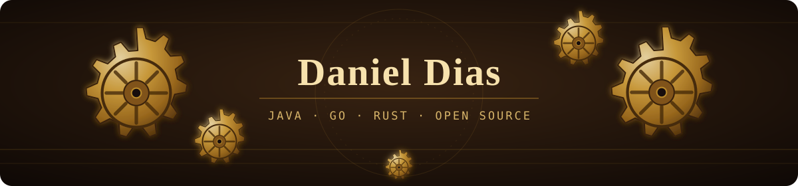

<div align="center">

<!-- BRASS CONSOLE TELEMETRY BAR -->
<code>⚙️ BRASS CONSOLE · MG-01 ❯ daniel@gearworks:~$ ./boot_workshop.sh | PWR · TMP 68°C · OIL 96% ⚙️</code>

<br/><br/>

<!-- ANIMATED HEADER SVG -->


<br/>

<!-- TYPING ANIMATION -->
<a href="https://git.io/typing-svg">
  
</a>

<br/><br/>

[](https://daniel-dos.github.io/danieldias/)
[](https://www.linkedin.com/in/daniel-dias)
[](https://medium.com/danieldiasjava)
[](https://tomee.apache.org/)

<br/>


</div>

---

## ⚙️ `daniel@gearworks:~$ whoami --workshop`

> *"clockwork // distributed systems — the workshop of a software engineer"*

As a Software Engineer at **Itaú Unibanco**, I build and modernize backend systems, transitioning legacy monoliths into resilient microservices using **Java**, **Go**, and **Rust**.

Beyond my day job, I'm a **committer on [Apache TomEE](https://tomee.apache.org/)** and contributor to **Jakarta EE**, **MicroProfile**, and **EclipseEE4J** — actively shaping the future of enterprise Java.

Currently on a journey learning **Rust** 🦀 — exploring memory safety, testing, and systems programming inside the gearworks.

### 🔧 Core Workshop Pillars

| ⚙️ Real-World Technical Content | 📐 Focus on Best Practices | 🌐 Open Source & Community |
| :--- | :--- | :--- |
| Real experiences with Java, Go, Rust, and more — from the daily work of building distributed systems. | Clean architecture, readable code, testing, and scalable solutions. Solid engineering foundations. | Apache Foundation projects, distributed systems, and tools that drive technical growth beyond any single stack. |

---

## ⚙️ `daniel@gearworks:~$ whoami --code`

<details open>
<summary>☕ <b>Java (Engine Core)</b></summary>

```java
public class DanielDias implements SoftwareEngineer {

    private final String workshop  = "Gearworks · MG-01";
    private final String employer  = "Itaú Unibanco";
    private final String oss       = "Apache TomEE Committer | Jakarta EE & EclipseEE4J Contributor";
    private final String focus     = "Distributed Systems · Clean Architecture · Open Source";
    private final String learning  = "Rust 🦀";
    private final String[] stack   = {"Java", "Go", "Rust"};

    @Override
    public String passion() {
        return "Forged with brass & code — building software that evolves with the business.";
    }
}
```
</details>

<details>
<summary>🐹 <b>Go (Concurrency Valve)</b></summary>

```go
package main

import "fmt"

type SoftwareEngineer interface {
    passion() string
}

type DanielDias struct {
    workshop string
    employer string
    oss      string
    focus    string
    learning string
    stack    []string
}

func (d DanielDias) passion() string {
    return "Forged with brass & code — building software that evolves with the business."
}

func main() {
    daniel := DanielDias{
        workshop: "Gearworks · MG-01",
        employer: "Itaú Unibanco",
        oss:      "Apache TomEE Committer | Jakarta EE & EclipseEE4J Contributor",
        focus:    "Distributed Systems · Clean Architecture · Open Source",
        learning: "Rust 🦀",
        stack:    []string{"Java", "Go", "Rust"},
    }
    fmt.Println(daniel.passion())
}
```
</details>

<details>
<summary>🦀 <b>Rust (Gearbox Telemetry)</b></summary>

```rust
trait SoftwareEngineer {
    fn passion(&self) -> &'static str;
}

struct DanielDias {
    workshop: &'static str,
    employer: &'static str,
    oss:      &'static str,
    focus:    &'static str,
    learning: &'static str,
    stack:    [&'static str; 3],
}

impl SoftwareEngineer for DanielDias {
    fn passion(&self) -> &'static str {
        "Forged with brass & code — building software that evolves with the business."
    }
}

fn main() {
    let daniel = DanielDias {
        workshop: "Gearworks · MG-01",
        employer: "Itaú Unibanco",
        oss:      "Apache TomEE Committer | Jakarta EE & EclipseEE4J Contributor",
        focus:    "Distributed Systems · Clean Architecture · Open Source",
        learning: "Rust 🦀",
        stack:    ["Java", "Go", "Rust"],
    };
    println!("{}", daniel.passion());
}
```
</details>

---

## ⚙️ `daniel@gearworks:~$ cat stack.rs`

<div align="center">

<!-- SKILLS SVG CHART -->


<br/><br/>

<!-- LANGUAGES BAR CHART via github-readme-stats -->


</div>

<br/>

| Gear Layer | Technologies |
|---|---|
| **⚙️ Languages** |    |
| **⚙️ Frameworks** |     |
| **⚙️ Messaging** |    |
| **⚙️ Data** |    |
| **⚙️ Infra** |      |
| **⚙️ Testing** |    |
| **⚙️ Blueprints** | `DDD` `Clean Architecture` `SOLID` `Hexagonal` `Event-Driven` |

---

## ⚙️ `daniel@gearworks:~$ cat /opensource`

> *Open source is where I give back to the community that shaped my career.*

<div align="center">

[](https://github.com/apache/tomee)
[](https://github.com/eclipse-ee4j/krazo)

[](https://github.com/jakartaee/mvc-api)
[](https://github.com/apache/deltaspike)

</div>

| Project | Role | Description |
|---|---|---|
| [**Apache TomEE**](https://github.com/apache/tomee) | ⚙️ **Committer** | Enterprise Java runtime — core features, bug fixes & DX |
| [**Apache TomEE Site**](https://github.com/apache/tomee-site-generator) | ⚙️ **Committer** | Official TomEE documentation & website |
| [**Jakarta MVC**](https://github.com/jakartaee/mvc-api) | 🔧 Contributor | Jakarta MVC specification |
| [**Eclipse Krazo**](https://github.com/eclipse-ee4j/krazo) | 🔧 Contributor | Reference implementation of Jakarta MVC |
| [**Apache DeltaSpike**](https://github.com/apache/deltaspike) | 🔧 Contributor | CDI extensions for Jakarta EE |

---

## ⚙️ `daniel@gearworks:~$ cat /experience`

- 🏦 **Itaú Unibanco** — Modernizing large-scale financial systems: decomposing monoliths into microservices with DDD, Clean Architecture, Kafka and Apache Camel
- ⚙️ **API Design** — Designing RESTful APIs for high-throughput, low-latency financial services
- 📊 **Observability** — Full observability with Datadog: metrics, distributed traces, dashboards and alerts
- ☁️ **AWS Infrastructure** — EC2, ECS, S3, RDS; infrastructure-as-code with Terraform
- 🔁 **CI/CD** — Building and maintaining delivery pipelines with Jenkins
- 📨 **Distributed Messaging** — Event-driven architectures with Kafka, Camel and Apache Pulsar (Java producers + Go consumers)
- 🛡️ **Performance Tuning** — Profiling and optimizing Java services under high load in production

---

## ⚙️ `daniel@gearworks:~$ tail /blog/latest`

> *Writing about Java, Go, Rust, and distributed systems — straight from the workshop*

**2026**

| | Post | Tags |
|---|---|---|
| 🦀 | [Testing in Rust — From Java and Go to Crates and Modules](https://daniel-dos.github.io/danieldias/blog/2026/02/25/testing-in-rust/test-in-rust) | `Rust` |
| 🦀 | [My Journey Learning Rust](https://daniel-dos.github.io/danieldias/blog/2026/02/19/my-journey-learning-rust/my_journey_learning_rust) | `Rust` |
| 📊 | [A Beginner's Journey into HTTP, Load Testing, and Observability](https://daniel-dos.github.io/danieldias/blog/2026/01/14/a-beginners-journey-into-http-load-testing-and-observability/a_beginners_journey_into_http_load_testing_and_observability) | `Observability` |
| 🌐 | [Becoming an Open Source Contributor with Apache TomEE](https://daniel-dos.github.io/danieldias/blog/2026/01/02/Becoming-an-Open-Source-Contributor-with-Apache-TomEE) | `OSS` `Java` |

**2025**

| | Post | Tags |
|---|---|---|
| ☕ | [Java Talks, Go Listens: My First Apache Pulsar App](https://daniel-dos.github.io/danieldias/blog/java-talks-go-listens-my-first-apache-pulsar-app) | `Java` `Go` `Pulsar` |
| 📦 | [Using Jakarta Data with Apache TomEE: A Step-by-Step Tutorial](https://daniel-dos.github.io/danieldias/blog/using-jakarta-data-with-apache-tomEE-a-step-by-step-tutorial) | `Java` `OSS` |

➡️ [Read the Blog](https://daniel-dos.github.io/danieldias/blog) · [Blog-Rust](https://daniel-dos.github.io/danieldias/) · [Medium](https://medium.com/danieldiasjava)

---

## ⚙️ `daniel@gearworks:~$ ./telemetry --stats`

<div align="center">


<br/><br/>


</div>

---

## ⚙️ `daniel@gearworks:~$ ping daniel`

<div align="center">

[](https://daniel-dos.github.io/danieldias/)
[](https://www.linkedin.com/in/daniel-dias)
[](https://medium.com/danieldiasjava)
[](https://github.com/daniel-dos)
[](https://www.apache.org)

<br/>

<sub>⚙️ <b>forged with brass & code</b> · <i>clockwork // distributed systems</i></sub>

<br/><br/>


</div>
